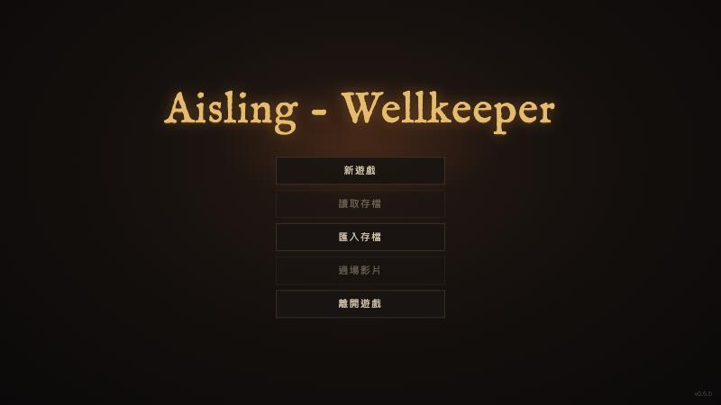
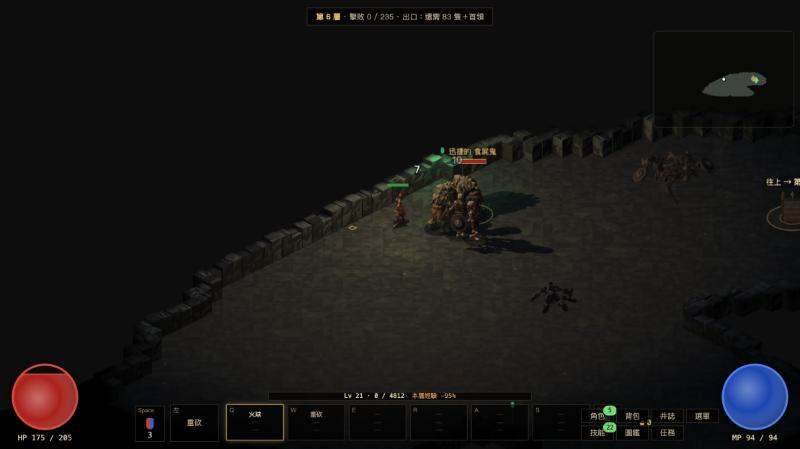

# Aisling - Wellkeeper

### [▶ 線上遊玩](https://kochinchen.github.io/aisling-wellkeeper/)

https://kochinchen.github.io/aisling-wellkeeper/　·　用 Chrome 或 Edge 開啟，不必安裝

## 遊戲介紹

一口深不見底的井，三十五層，一層比一層古老。守井人 Aisling 拿著燭火往下走，
一路打倒從石縫裡爬出來的怪物，撿起前人留下的遺物與筆記，拼回這口井真正的故事。

- **斜角視角的動作 RPG**：左鍵移動與攻擊，右鍵施放連段；Q / W / E 三組連段，招式的順序會觸發不同的組合技。
- **三十五層、七個區域**：地下村落與古墓、墮落聖堂、礦坑與熔岩、騎士要塞、古代王宮，一路到井底的深淵；每五層換一種景色與一首管弦配樂，每區最後一層有魔王，牆後還藏著隱藏魔王。
- **《井誌》**：散落在各層的遺物、魔王倒下時的魂魄、寶箱裡的挑戰者筆記，合成一本 69 頁的書（遊戲中按 Y）。

## 遊戲賣點

- 🔥 **自己製作熔核**：把用不到的裝備融成熔核，鑲進裝備的孔裡。橘色傳奇裝備的特殊技能也能灌注到熔核裡，改裝到其他裝備上使用！
- ⬆️ **飛昇**：喜歡的裝備不夠力？用飛昇把它提升上來，陪你一路打到井底！
- ⚔️ **武器灌注**：把法術灌進武器，打造你的魔劍士、魔弓手！
- 📦 **共用寶箱**：三個存檔欄位共用一個倉庫，好裝備可以留給下一個角色。
- 👑 **四個隱藏魔王**：牆後封著四個隱藏魔王，但想要打開，還要多跟一路上的盜墓者套交情！幫他們找東西、付錢，或把撿到的地牢遺物交還給原本的主人，還能換到技能點、藥水上限或裝備升級。

## 操作

左鍵移動 / 攻擊、右鍵施放連段、Q / W / E 切換連段、Space 喝藥水、
I 背包、C 角色、T 技能、K 怪物圖鑑、O 裝備圖鑑、Tab 地圖、Esc 選單（選單裡的「操作說明」有完整列表）。

遊戲會自動存檔在這個瀏覽器裡；換電腦時用選單的「匯出存檔」、到新的地方再「匯入存檔」。

## 文件

| 文件 | 內容 |
| --- | --- |
| [▶ 線上遊玩](https://kochinchen.github.io/aisling-wellkeeper/) | 遊戲本體 |
| [怪物圖鑑](https://kochinchen.github.io/aisling-wellkeeper/design/codex.html) | 所有怪物的縮圖、各樓層的怪物數值、魔王與隱藏魔王的數值與能力 |
| [裝備圖鑑](https://kochinchen.github.io/aisling-wellkeeper/design/items.html) | 稀有度、掉落機率、裝備基底、詞綴、傳奇與神話裝備、熔核、地牢遺物 |
| [角色成長模擬](https://kochinchen.github.io/aisling-wellkeeper/design/growth.html) | 成長表、技能點模擬器、Combo 測試、融合試算 |
| [組合技圖鑑](https://kochinchen.github.io/aisling-wellkeeper/design/combos.html) | 七組連段的組合技規則與所有會觸發的排列 |
| [井誌（小說）](https://kochinchen.github.io/aisling-wellkeeper/design/novel.html) | 完整小說：年老的主角一層一層講給孩子聽 |

這裡只放打包好的遊戲與上面這些文件。
