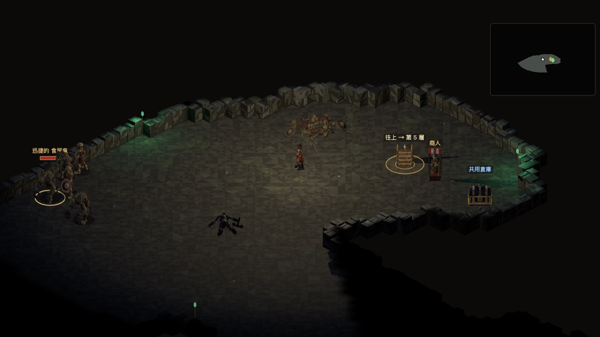

# Aisling - Wellkeeper

### [▶ 線上遊玩](https://kochinchen.github.io/aisling-wellkeeper/)

https://kochinchen.github.io/aisling-wellkeeper/　·　用 Chrome 或 Edge 開啟，不必安裝

## 遊戲介紹

一口深不見底的井，三十五層，一層比一層古老。守井人 Aisling 拿著燭火往下走，
一路打倒從石縫裡爬出來的怪物，撿起前人留下的遺物與筆記，拼回這口井真正的故事。

這是一款斜角視角的動作 RPG（ARPG）：砍怪、撿寶、打魔王、把裝備越磨越強。
不必安裝、不必註冊，用瀏覽器打開就能玩，存檔也自動存在瀏覽器裡。

- **三十五層、七個區域**：地下村落與古墓、墮落聖堂、礦坑與熔岩、騎士要塞、古代王宮，一路到井底的深淵。每五層換一種景色，每區最後一層有一場魔王戰，總共 49 種怪物。
- **連段與組合技**：左鍵移動與攻擊，右鍵施放連段。招式排列的順序不同，會觸發不同的組合技，同一套技能也能打出不一樣的節奏。
- **六種稀有度的裝備**：白、藍、黃、紫、橘（傳奇）、紅（神話），每件裝備的詞綴都是隨機的，傳奇與神話還有專屬的特殊效果。
- **真正的管弦配樂**：用真實樂器的取樣演奏，越往下越悲壯；血量低時會加入緊張的小提琴，每個魔王都有自己的曲子。
- **《井誌》**：散落在各層的遺物、魔王倒下時留下的魂魄、寶箱裡的挑戰者筆記，合成一本 69 頁的書（遊戲中按 Y），每收集四分之一還有獎勵。據說還有第 70 頁……

## 遊戲賣點

### 🔥 自己製作熔核，把橘裝的力量帶著走

用不到的裝備不必賣掉：把 2～4 件丟進熔爐，融成一顆熔核，鑲進裝備的孔裡。
熔核的強度看投入裝備的等級（T1～T5），四件同一種類融出「純核」還會多一條屬性。

更厲害的是，**橘色傳奇武器的招牌能力也能灌注進熔核**，變成熔核上的「印記」，
改鑲到其他裝備上照樣生效！喜歡的傳奇能力，不必被綁在同一把武器上。

孔數和稀有度相反：白裝最多 5 孔、藍裝 4 孔……一件鑿滿、鑲滿同一種熔核的白裝，
每個孔再加 10% 效果，也能打造成不輸傳奇的神裝。

### ⬆️ 飛昇：喜歡的裝備不夠力？讓它跟著你往下走

早期撿到的好裝備，到了深層數值跟不上？用**飛昇**把它的基底升到下一階，
最高第 8 階，詞綴和鑲好的熔核都保留。第 5 階起需要魔王掉落的飛昇碎片，
花心思打造的裝備可以陪你一路打到井底。

### ⚔️ 武器灌注：打造你的魔劍士、魔弓手

劍、斧、弓也想放魔法？把一把**法杖**和 2～6 顆法杖純核一起灌進武器，
武器就能繼承法杖的法術強度（最高 100%）。近戰砍怪、順手丟火球的**魔劍士**，
邊射箭邊落雷的**魔弓手**，由你自己決定。

### 📦 共用寶箱

三個存檔欄位共用同一個倉庫（5 頁、150 格，放裝備和熔核）。
這個角色用不到的好東西，存起來留給下一個角色；開新角色也不必從零開始。

### 👑 四個隱藏魔王，先跟盜墓者套交情

牆後封著**四個隱藏魔王**：奪界雙手、萬骸之口、噬界足眼、鎏金三王。
它們比同層的魔王更強，也掉更好的東西——但想要打開封印，
還要多跟一路上的**盜墓者**套交情！

井裡不只你一個人。十二個盜墓者散在各層，有人要錢、有人要裝備，
有人只是想找回一件東西。幫他們完成委託，或把撿到的**地牢遺物**
交還給原本的主人，就能換到技能點、自由屬性點、藥水上限、免費升級裝備，
還有隱藏魔王的線索。任務本（按 U）會記下每一件委託和聽來的小道消息。

## 遊戲畫面

## 操作

左鍵移動 / 攻擊、右鍵施放連段、Q / W / E 切換連段、Space 喝藥水、
I 背包、C 角色、T 技能、K 怪物圖鑑、O 裝備圖鑑、Tab 地圖、Esc 選單（選單裡的「操作說明」有完整列表）。

遊戲會自動存檔在這個瀏覽器裡；換電腦時用選單的「匯出存檔」、到新的地方再「匯入存檔」。

## 文件

| 文件 | 內容 |
| --- | --- |
| [▶ 線上遊玩](https://kochinchen.github.io/aisling-wellkeeper/) | 遊戲本體 |
| [怪物圖鑑](https://kochinchen.github.io/aisling-wellkeeper/design/codex.html) | 所有怪物的縮圖、各樓層的怪物數值、魔王與隱藏魔王的數值與能力 |
| [裝備圖鑑](https://kochinchen.github.io/aisling-wellkeeper/design/items.html) | 稀有度、掉落機率、裝備基底、詞綴、傳奇與神話裝備、熔核、地牢遺物 |
| [角色成長模擬](https://kochinchen.github.io/aisling-wellkeeper/design/growth.html) | 成長表、技能點模擬器、Combo 測試、融合試算 |
| [組合技圖鑑](https://kochinchen.github.io/aisling-wellkeeper/design/combos.html) | 七組連段的組合技規則與所有會觸發的排列 |
| [井誌（小說）](https://kochinchen.github.io/aisling-wellkeeper/design/novel.html) | 完整小說：年老的主角一層一層講給孩子聽 |

這裡只放打包好的遊戲與上面這些文件。
